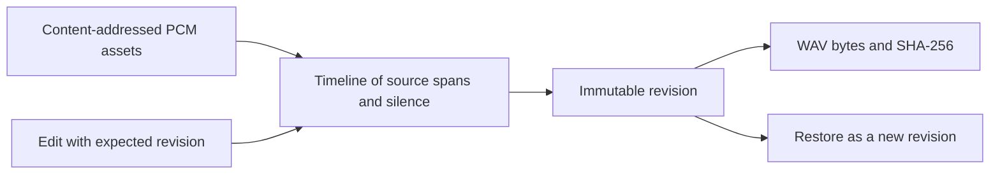

[🇬🇧 English](README.md) | [🇷🇺 Русский](README.ru.md)

# Audio Revision Engine

Replace a section of an audio track, insert a pause, and restore a previous edit. Every revision can be rendered to a WAV file and checked against its SHA-256 hash.

This standalone TypeScript showcase illustrates a challenge from audiobook post-production. An editor needs to correct a small section, hear the result in context, and keep the original takes available for review.

[Download original WAV](https://raw.githubusercontent.com/NataAntro/audio-revision-engine/main/examples/original.wav) · [Download edited WAV](https://raw.githubusercontent.com/NataAntro/audio-revision-engine/main/examples/edited.wav) · [Download restored WAV](https://raw.githubusercontent.com/NataAntro/audio-revision-engine/main/examples/restored.wav) · [Revision report](examples/revisions.json)

## Run the demo

Requires Node.js 22.18 or later.

```sh
npm ci
npm run check
npm test
npm run demo
```

The demo generates four synthetic tones and uses them to build three versions of a track. Open the WAV files in any audio player or inspect the source spans and hashes in `out/revisions.json`.

| Revision | What to listen for                                   | Output             |
| -------- | ---------------------------------------------------- | ------------------ |
| 1        | Three ascending tones                                | `out/original.wav` |
| 2        | A new middle tone followed by a pause                | `out/edited.wav`   |
| 3        | The original three tones, restored as a new revision | `out/restored.wav` |

The demo checks that revisions 1 and 3 have identical WAV hashes and that revision 2 has a different hash.

## Engineering decisions

- **Edit references to source audio.** Each revision stores an ordered list of source spans and silence. Asset IDs are derived from the PCM WAV bytes, and the asset store copies input samples before retaining them.
- **Use sample coordinates.** A replacement targets a half-open range in the current audible timeline. It can cross an existing splice while preserving exact offsets in the underlying sources.
- **Preserve history.** An edit or restore checks the expected current revision. A stale edit fails. A successful restore appends a revision with both its parent and its restore target.
- **Render a specific revision.** The renderer concatenates the referenced samples and emits a mono, 16-bit PCM WAV. The tests verify the WAV header, exact output samples, source immutability, and stale-edit handling.



The public implementation uses synthetic audio and in-memory storage. The package has no runtime dependencies.

[Timeline and renderer](src/audio.ts) · [Synthetic demo](src/demo.ts) · [Tests](tests/audio.test.ts)
