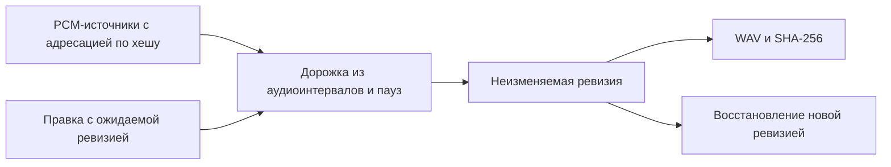

[🇬🇧 English](README.md) | [🇷🇺 Русский](README.ru.md)

# Неразрушающий монтаж аудио

Замените участок аудиодорожки, вставьте паузу и восстановите прежний монтаж. Каждую ревизию можно отрендерить в WAV и проверить по хешу SHA-256.

Этот самостоятельный пример на TypeScript показывает задачу из постпродакшена аудиокниг. Редактору нужно исправить небольшой участок, прослушать результат в контексте и сохранить исходные дубли для проверки.

[Скачать исходный WAV](https://raw.githubusercontent.com/NataAntro/audio-revision-engine/main/examples/original.wav) · [Скачать WAV после правки](https://raw.githubusercontent.com/NataAntro/audio-revision-engine/main/examples/edited.wav) · [Скачать восстановленный WAV](https://raw.githubusercontent.com/NataAntro/audio-revision-engine/main/examples/restored.wav) · [Отчёт по ревизиям](examples/revisions.json)

## Запуск

Требуется Node.js 22.18 или новее.

```sh
npm ci
npm run check
npm test
npm run demo
```

Демо генерирует четыре синтетических тона и собирает из них три версии дорожки. WAV можно открыть в любом аудиоплеере, а интервалы исходников и хеши посмотреть в `out/revisions.json`.

| Ревизия | Что слышно                                        | Файл               |
| ------- | ------------------------------------------------- | ------------------ |
| 1       | Три восходящих тона                               | `out/original.wav` |
| 2       | Новый средний тон и пауза после него              | `out/edited.wav`   |
| 3       | Исходные три тона, восстановленные новой ревизией | `out/restored.wav` |

Демо проверяет, что хеши WAV ревизий 1 и 3 совпадают, а хеш ревизии 2 отличается.

## Инженерные решения

- **Правки ссылок на исходники.** Каждая ревизия хранит упорядоченный список аудиоинтервалов и пауз. Идентификатор исходника вычисляется по байтам PCM WAV. Хранилище копирует входные сэмплы.
- **Координаты в сэмплах.** Замена применяется к полуоткрытому интервалу текущей слышимой дорожки. Интервал может пересекать существующую склейку. Смещения внутри исходников сохраняются точно.
- **История ревизий.** Перед правкой или восстановлением движок проверяет ожидаемую текущую ревизию и отклоняет устаревшую операцию. Восстановление добавляет новую ревизию со ссылками на предшественника и восстановленную версию.
- **Рендер конкретной ревизии.** Рендерер объединяет сэмплы перечисленных интервалов и формирует монофонический 16-битный PCM WAV. Тесты проверяют заголовок WAV, сами сэмплы, неизменность исходников и отклонение устаревших правок.



В публичной реализации используются синтетическое аудио и хранение в памяти. У пакета нет зависимостей времени выполнения.

[Дорожка и рендер](src/audio.ts) · [Синтетическое демо](src/demo.ts) · [Тесты](tests/audio.test.ts)
